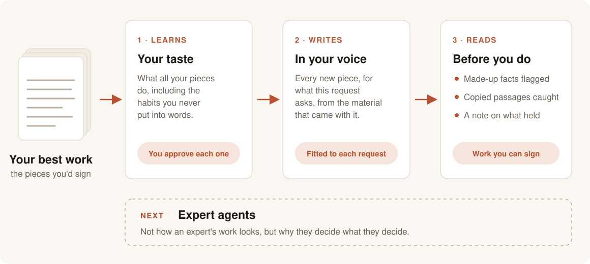

# Atelier

### Your voice, on every piece your agents write. Nothing made up, nothing copied.

**You can tell the draft isn't yours. You usually can't say why.** That's the whole frustration in one line. You hand a post to an agent because there's more writing than there are evenings, and what comes back is fluent, competent, and wearing someone else's face. It opens with a summary you'd never write. It hedges in the exact place you'd commit. You paste in three of your own posts as examples, and it gets the surface right, then invents a statistic you never saw and hands a paragraph of yours back to you as if it were new. So you rewrite it yourself, or you skim it and hope. One costs your nights. The other costs your name.

[](https://github.com/yannickYamo/atelier/actions/workflows/ci.yml)
[](LICENSE)
[](package.json)

<p align="center"></p>

## The problem

Taste is the part nobody wrote down. You know your own rules: where you refuse to hedge, which figures you'd never cite without a sample size, the fact that you always name who's answerable at the end. But they live in your hands, not in a doc. A system prompt can only ask for what you can articulate. A model judge scores a draft 7 out of 10 against its own idea of good, which is the average of everyone's writing and therefore nobody's. Neither one knows what *your* good is, so neither can hold a draft to it.

And the failure isn't only stylistic. Fluent drafts invent. They attribute, they quantify, they tell a story that sounds like one of yours because it was assembled out of one of yours. You're the one signing it.

## What it does

**It learns your taste.** Atelier reads your existing work and infers what good looks like to you, including the habits you've never named. Then it shows you what it found, one rule at a time, and you rule on each one. Approved rules become a versioned standard: yours, in your words, not something a model can quietly reword on the next run.

**It writes in your voice.** For each new request, it writes against that standard: what this piece asks for, what source material came with it, which of your habits actually apply here (and which don't: a rule that fits a long guide shouldn't be forced onto a release note).

**It reads every piece before you do.** Every figure, name, and anecdote gets checked against the material you supplied; anything that isn't there gets flagged. Passages lifted from your own examples get caught too, because a story of yours that wasn't given to this piece isn't this piece's to tell. What lands in front of you comes with a note: what held, what it repaired, and what's still yours to decide.

## What's shown so far

- **Blind readers ranked Atelier's pieces first** on a single read, ahead of the same model given the author's own posts as examples.
- **The voice holds on piece five hundred the way it holds on piece one,** because the standard is read fresh against each one rather than drifting out of a context window.
- **0 invented specifics across 60 pieces.** Plain prompting and pasted examples produced between 37 and 67 per corpus.
- **46 of 46 planted inventions caught.**

How each was measured, and what isn't established yet, is in [EVALS](EVALS.md).

## Try it

```bash
npm install -g @yannickyamo/atelier

atelier new ./my-posts "blog posts like these" --name posts   # learn your taste from your pieces
atelier run "a post on why we moved off the queue" --with notes=notes.md   # write in your voice
atelier verify --skill posts draft.md --with notes=notes.md   # read any draft, yours or an agent's
```

`atelier setup` lets the coding agents in a project (Claude Code, Codex) call it on their own drafts. Not happy with a piece? `atelier fix "the opening was too abstract"` and say it in your own words. [examples/blog](examples/blog) has six posts to try it on.

Here is what comes back when an agent's draft invents a source and lifts a paragraph from one of your posts:

```text
  ✗ Every specific in the work is found in what you supplied: 1 not found in it, and still in the text
  ✗ No passage is lifted from one of your examples: a run of 33 words is shared with one of them (11 at most)
```

## Against the alternatives

| What you'd reach for | What you get | What Atelier adds |
|---|---|---|
| **A system prompt** | A request the model may or may not honour | Your habits read from your own work, held on every piece |
| **Pasting your examples** | The look, plus whatever it invents | The look, with every figure traced to your material and your own paragraphs left yours |
| **A model judge** | 7 out of 10 | The sentence, and the habit it broke |
| **Reading every draft yourself** | Your evenings | Your attention, spent only where a call is yours to make |

## Where it's going

Writing is the first expert we taught it, not the last. An expert isn't defined by how their output looks. It's defined by why they decide what they decide: which number they question, what they cut, when they push back on the brief. And it's rarely the procedure someone wrote down for them. It's the judgment that never made it into the procedure. Atelier is learning that part, and then holding every agent to it.

## Why I built it

I was the person signing agent-written drafts I hadn't fully read. The responsibility didn't shrink when the typing did. It moved, from writing the sentence to signing for it. Atelier exists so that signature means something again.

## More

[USAGE](docs/USAGE.md) has every command. [AGENTS.md](AGENTS.md) is the short version for a coding agent. [EVALS](EVALS.md) has what was measured and what was not. [MEASUREMENTS](MEASUREMENTS.md) lists every figure a code comment states. Node 22 or later; writing and the deeper reads need `ANTHROPIC_API_KEY` or an OpenAI-compatible backend, and `atelier check` tests it before anything is spent. No account, no telemetry: everything stays in `~/.atelier`.

## License

Source-available. Unmodified copies may be used and redistributed; modification is reserved to the authors. See [LICENSE](LICENSE). Reports of what it got right and wrong on your own writing are welcome: see [CONTRIBUTING](CONTRIBUTING.md).
