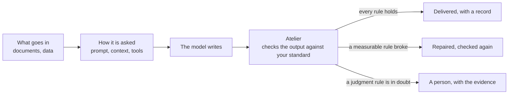
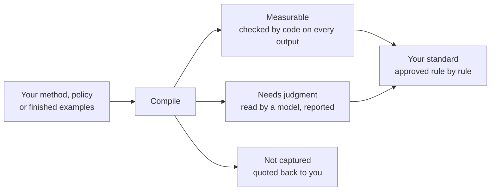
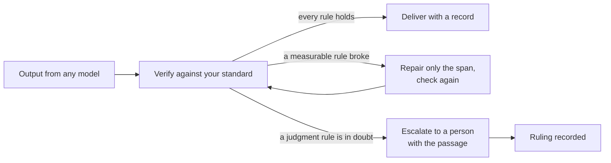
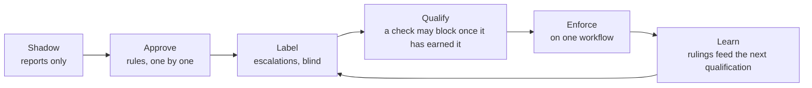

# Atelier

### Your standard, held on every AI output.

**Atelier turns the standard your experts hold work to into checks, runs every output through them, repairs what breaks a measurable rule, escalates what needs judgment, and records what was checked and what was not.**

[](https://github.com/yannickYamo/atelier/actions/workflows/ci.yml)
[](LICENSE)
[](package.json)

[Quickstart](#quickstart) · [How it works](#how-it-works) · [Examples](#examples) · [What is measured](#what-is-measured) · [FAQ](#faq) · [Documentation](#documentation)

A model writes a claims memo, a code review, a contract clause, a brand-safety label, a blog post. Someone has a written standard for that work. Atelier is the step between the model and the reader: the standard, compiled into checks, applied to this output, now, with the passage as evidence and a record of the result.

## The problem

Thousands of outputs a day are produced against a written standard, and a sample is reviewed. The rest ships on the assumption that the model held the standard as well on the thousandth output as on the first. Three things go wrong in that gap:

- **Drift without a witness.** The tenth answer breaks a rule the first one held, and nothing says which answer, which rule, or why.
- **Instructions mistaken for enforcement.** A skill file, a system prompt or a policy document asks for a shape. Nothing checks that the shape arrived.
- **Verdicts without error rates.** A guardrail or a judge model says "pass" with no statement of how often it is wrong on the organisation's own work.

Atelier addresses the gap directly. Every output is checked against the standard before it ships. What a check can decide, code decides. What needs judgment is read by a model and reported, with a measured error rate, before it is allowed to block. What the compiler could not capture is quoted back to the owner of the standard rather than silently dropped.

## How it is different

| Approach | What it improves | Where Atelier differs |
|---|---|---|
| **Prompt and trace optimizers** (GEPA, DSPy, SkillOpt) | The average quality of future outputs | Atelier inspects the output that exists now, rule by rule, with the passage as evidence. Both are useful; they act on different steps. |
| **Skill creators** | The instructions a coding agent follows | A skill is an instruction. Atelier compiles the same method into checks that run on every output and reports which rules it can only read. |
| **Evals** | Knowledge of how a system performs on a set | An eval scores a set after the fact. Atelier gates each output before delivery and records the result. |
| **Guardrails** | Enforcement of rules a developer wrote | Atelier compiles the rules the experts hold, from the documents they already have, and states which rules it can measure, which it can only read, and which it could not capture. |
| **Schema checks** | The shape of structured output | A schema is one of Atelier's checks. Atelier also checks content: figures that reconcile, specifics traced to supplied material, cited evidence that exists, banned terms, required sections, judgment rules read by a model. |



Everything upstream makes the model more likely to be right. Atelier is the fourth step: it catches the output that is not, and says which output, which rule, and why.

## How it works

**Once: the standard becomes checks.** Atelier reads a method note, a policy, or finished examples, and produces a compile report in three columns before anything runs.



**Every output: checked, repaired, or escalated, and recorded.**



**Over time: checks earn authority without the standard changing.**



Three rules hold throughout:

1. Only the owner changes the standard. A model's reading never does. Standards are versioned by content, apart from the model.
2. A rule a model reads never blocks until it has proved its error rate on the owner's own labels. A counted rule, such as a banned term or a required section, is decided by code and blocks from the first run.
3. The record never says a rule was checked when it was only read.

## Quickstart

Node 22 or later. Steps that call a model need `ANTHROPIC_API_KEY` or any OpenAI-compatible backend; checking text against an existing skill needs no key.

```bash
git clone https://github.com/yannickYamo/atelier && cd atelier
npm install && npm run build && npm link      # puts `atelier` on your PATH
atelier check                                  # tests the model backend before anything is spent
atelier setup                                  # registers the Atelier MCP server with the coding agents in this project
```

Build a standard from your own work, run it, and check anything against it:

```bash
atelier new ./examples --method how-we-do-it.md --name my-skill   # your method and finished examples become checks
atelier run "write the release notes for v2.1"                    # drafted, checked, repaired, recorded
atelier verify --skill my-skill draft.md                          # check any text; exit 1 if a required rule broke
atelier verify --skill my-skill draft.md --repair                 # repair only the spans that broke a required rule
atelier verify --skill my-skill --hook                            # as a Claude Code hook: exit 2 blocks with the reasons
atelier fix "the opening was too abstract"                        # correct a piece, or the standard, in your words
```

`atelier new` shows the compile report and builds nothing until the rules are approved. `atelier run` prints the work and, under it, the evaluation rule by rule, opening with where it stands: VERIFIED, NEEDS REVIEW or BLOCKED. `atelier run --json` and `atelier verify --json` return the same record head: schema, state, standard version, skill version, certificate, record.

Standards and records stay under `~/.atelier`. No account, no telemetry.

## Examples

**Contract drafting.** A method note of eight steps and ten finished term sheets. Required sections, defined terms used as defined, a clause count within the house range, no "best efforts": all checked by code on every draft. Whether a limitation of liability is drafted "in the firm's posture" is read by a model, reported, and escalated when in doubt.

**Code review.** A review method and finished reviews of real diffs. The Summary, Must fix and Verdict sections, a verdict from the allowed set, a line reference for every defect named: checked by code. Whether the review weighed risk before style: judgment, read and reported.

**Writing.** A folder of posts and a note on how they are written. The method holds; every specific is traced to material the author supplied, and anything invented is cut when the material is bound; the author's counted habits are held and machine tells kept out. Atelier does not yet make a model sound like an author from a few pieces, and says so.

**Claims memos at volume.** A claims policy and the memos adjusters sign. Every fact cited to a document in the file, the cited document present, the reserve equal to the invoices, the coverage decision naming a clause, no speculative language: checks on every memo, with the passage as evidence where one fails. The exclusion decision itself is escalated with the file.

**Brand-safety labels.** A taxonomy, a labelling policy and labelled clips. Every label a valid category, every flagged category with a timecode inside the clip's duration and evidence copied verbatim from the transcript, overall risk equal to the highest flagged, no High without the depiction the policy requires: checked on every label, in the JSON the pipeline already emits.

The two enterprise examples are standing bench domains in [bench/standing/domains](https://github.com/yannickYamo/atelier/tree/main/bench/standing/domains), each with its policy, examples, material and planted defects. [examples/blog](examples/blog/README.md) is a six-post corpus to try.

## Where it plugs in

| Surface | Today | Next |
|---|---|---|
| CLI | `verify`, `run`, one JSON record head, exit codes (1 a required rule broke, 2 could not check) | |
| Claude Code | `verify --hook` as a PostToolUse or Stop hook; the MCP server through `atelier setup` | the hook installed by `atelier setup` |
| MCP | `atelier_verify`, `atelier_rules`, `atelier_new`, `atelier_run`, `atelier_report`, `atelier_rate`, `atelier_fix`, for Claude Code and Codex | a hosted endpoint |
| CI | `verify` as a step; a broken required rule fails the check | a pull-request comment |
| SDK | | `verify(standard, output, material)` in Python and TypeScript |
| Hosted | | shadow reports, the labelling queue, the record per output |

## What is measured

Every figure comes from a study in [studies/](studies/) with its design and its failures kept. Most are development evidence, not sealed results; the table says which.

| Claim | Result | Status |
|---|---|---|
| Nothing invented | 0 invented claims in 60 outputs across two corpora; plain prompting and pasted examples carried 37 to 67 flagged specifics per corpus | sealed |
| The method holds | Code review: checklist 7 of 10, the planted defect cited within two lines 9 of 10, every other approach 0 of 10. Contracts: 10 of 10, matched by one skill creator's skill | development |
| Counted rules hold | 31% of answers broke a counted rule, against 76% for a hand-written skill never shown the rules | development |
| Invented specifics caught | 46 of 46 planted inventions caught; clean drafts left alone 39 of 48 and 35 of 38; a pattern check on the same material caught 11 of 46 | sealed |
| Sounds like the author | Ranked first on blind reads of single pieces; the pre-registered gate as a whole failed | closed, not claimed |

Not yet established: a sealed win against a hand-written skill; error bounds on a real customer stream; the compile front door on arbitrary SKILL.md files, which is in progress. Details in [RESULTS](docs/RESULTS.md) and the CHANGELOG under Studies.

## FAQ

**What does Atelier check?**
Whatever the standard says: required sections and fields, allowed values, lengths and counts, banned terms, figures that reconcile, every specific traced to material the owner supplied, cited evidence that exists in the material, cross-field rules, and judgment rules read by a model and quoted back. The compile report shows which is which before anything runs.

**How is it different from an eval or an optimizer?**
Evals and optimizers improve the average over many runs. Atelier inspects this output, now, before it ships: which rules it held, which it broke, with the passage as evidence, and what happens next.

**How is it different from a guardrail or a schema check?**
A guardrail checks a rule a developer wrote. Atelier compiles the rules the experts hold, from their own documents, and states which it can measure, which it can only read, and which it could not capture. A rule a model reads never blocks until it has proved its error rate on the owner's labels.

**Does Atelier change outputs automatically?**
Only where a measurable rule broke, and only the span that broke it. A repair is kept only if it re-verifies clean on every rule it touched; a rewrite that changes a claim or a figure is refused. A missing section is not a repair: in a run the work is written again; in `verify` it stays blocked and says so. Anything that needs judgment goes to a person with the evidence.

**Who decides what "good" means?**
The owner of the standard. Every rule is approved before it binds, versioned by content apart from the model, and a model's reading cannot alter it. A new reader model starts unqualified and reports until the owner's labels qualify it.

**Does it add latency?**
Counted checks run offline in milliseconds. The invented-claim reader and the judgment reader are model calls in the request path when a key is set. There is no asynchronous path yet.

**How do I connect a pipeline?**
Today: the CLI (`verify` on a file, with the JSON record), the Claude Code hook, the MCP tools, or a CI step. `verify` takes one file per call; a folder is a loop. An SDK and a hosted endpoint are next.

**What happens when I change models?**
The standard stays. A new writer model is held to the same checks on every output. A new reader model starts unqualified and reports until qualified on the owner's labels. There is no gate yet that re-verifies a new model against labels before it goes live.

**How quickly can I see results?**
Nothing needs integrating first. One policy and the last outputs of one workflow, in whatever form they are in, come back as findings rule by rule with the passage behind each, and a statement of which rules can be enforced from the first run.

## Documentation

- [USAGE](docs/USAGE.md): every command.
- [AGENTS.md](AGENTS.md): instructions for coding agents using Atelier.
- [ARCHITECTURE](docs/ARCHITECTURE.md), [MEASUREMENTS](MEASUREMENTS.md), [RESULTS](docs/RESULTS.md), [COMPARISON](docs/COMPARISON.md), [ROADMAP](docs/ROADMAP.md).
- [docs/decisions](docs/decisions): the decision records, including [the closing rules](docs/decisions/0012-the-closing-rules.md).

## Contributing

Code changes are made by the authors. The contribution open to everyone is evidence: point Atelier at work whose standard you know, hold some of it back, and report what it got right, what sounded right and was wrong, and whether pasting the examples did as well. Negative results are kept. See [CONTRIBUTING](CONTRIBUTING.md).

## License

Source-available. Unmodified copies may be used and redistributed; modification is reserved to the authors. See [LICENSE](LICENSE).
