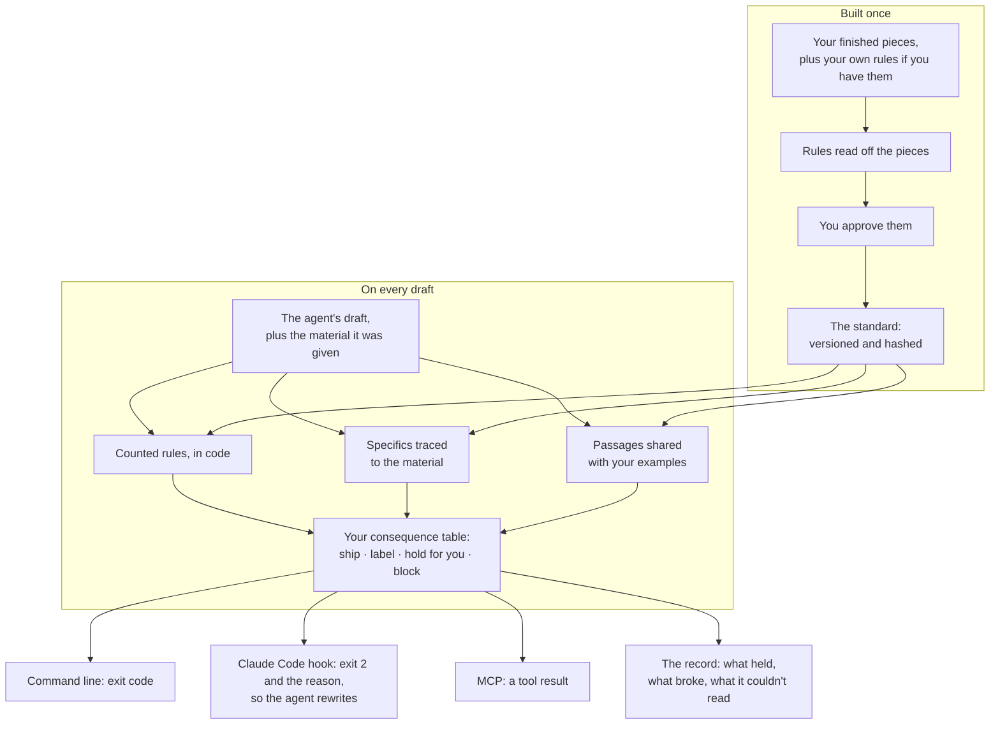

# Atelier

**Atelier flags what your agent made up. Figures, names, sources, stories that aren't in the material you handed it. It runs on every draft, not just the ones you happen to read.**

[](https://github.com/yannickYamo/atelier/actions/workflows/ci.yml)
[](LICENSE)
[](package.json)

## What it is

Atelier is a check any coding agent can call. It does three things. It flags invented specifics. It catches text copied too closely from your own examples, naming the shared run of words. And as a Claude Code hook it blocks rule breaks: exit 2, the rule and the offending span go back to the agent, the agent rewrites.

The rules come from finished pieces you'd sign, plus a note of your own rules if you keep one. You approve them before they bind.

## The problem

You ask an agent for a release note. It writes "cut p95 latency 40%." Nobody measured 40%. The sentence reads well, the structure is right, and it ships.

You ask it to write like your blog, and it pastes a paragraph from a post you published last year back at you.

The real constraint is that I can't read every draft. I run several agents at once and my attention doesn't scale with them. The drafts I skim are the ones carrying the invented figure, because invented figures read better than hedged ones.

The usual fixes miss this for structural reasons. An instruction in a system prompt is a request, and nothing afterward verifies it was honored. A model-as-judge returns 7 out of 10, which tells you nothing you can act on: not which sentence, not which rule, not whether to hold the draft. And the cost is lopsided. One invented figure costs more trust than every rule the draft kept.

## Three commands

```bash
npm install -g @yannickyamo/atelier

atelier new ./my-posts "blog posts like these" --name posts   # build the check from your pieces
atelier verify --skill posts draft.md --with notes=notes.md   # check any text against it
atelier setup                                                 # let the agents in this project call it
```

- `atelier new` builds the check from your pieces.
- `atelier verify` checks any text.
- `atelier setup` lets the agents in a project call it, through an MCP server for Claude Code and Codex.

To have Claude Code stop on a break, add `atelier verify --skill posts --hook` as a PostToolUse or Stop hook.

## How it works



### Build it once

Point it at your finished pieces, plus your own written rules if you have them. Rules get read off the pieces by counting what they all actually do; with an API key, a small model proposes the rest. **You approve the rules before they bind.** The approved set is versioned and hashed, so no model can add, drop, or reword one later.

### What happens on every draft

Three readings, then a decision.

- **Counted rules, in code.** Length, structure, banned phrases, machine-writing tells. Every break comes back with its span.
- **Specifics traced to source.** Figures, names, dates, citations checked against the material the agent was handed. Offline it's a pattern check; with a key, a small model reads for them.
- **Overlap with your own examples.** A run of shared words past a set limit gets named, with the words shown.

Then a table you control decides the consequence: ship, ship labeled, hold for you, or block. Pick strict, grounded, or creative and the defaults come with it. **Strict**: an untraced figure stops the work. **Grounded** (default): flagged for your review. **Creative**: listed, nothing blocked.

The answer returns in the shape the caller used: an exit code on the command line, exit 2 plus the reason to a Claude Code hook so the agent rewrites itself, a tool result over MCP. Every run is recorded: what held, what broke, what it couldn't read. It never reports checked when it only looked.

When it repairs, it rewrites only the span that broke a required rule, and keeps the rewrite only if the rewrite checks clean.

Measured on 60 outputs: 0 invented specifics, against 37 to 67 per corpus for plain prompting and for pasted examples, with the same reading for every approach. Of 46 planted inventions, 46 were caught; the pattern check alone caught 11. About one clean draft in five picks up a false flag you dismiss. The full numbers, misses included, are in [EVALS](EVALS.md).

It also writes to the standard: `atelier run`, then `atelier fix` in your own words. I'd hold that part loosely. The writing claim hasn't been tested blind yet.

The judgment didn't go away. It moved to the moment you approved the rules.

## Example

A draft from an agent, checked against six sample posts and the notes the agent was given. One sentence carried a figure and a source the notes never had; one paragraph was lifted from a sample post. Both come back named, offline, with no API key:

```text
  ✗ Every specific in the work is found in what you supplied: 1 not found in it, and still in the text
  ✗ No passage is lifted from one of your examples: a run of 33 words is shared with one of them (11 at most):
    "we did not replace the vendor three people wanted to the vendor was not the problem the coupling was ..."
```

As a hook, the same check exits 2 and hands the agent this, so it rewrites before you read anything:

```text
atelier: this breaks 1 required rule(s) of the "posts" standard. Rewrite only what each names, keep everything else as it is:
  - Every specific in the work is found in what you supplied: 1 not found in it, and still in the text
```

[examples/blog](examples/blog) has the six posts to try it on.

## Against the alternatives

**A system prompt asks. Atelier checks.** "Don't invent statistics" is a hope with no reading behind it.

**A model judge gives you a score.** Atelier names the sentence and the rule it broke. You can't rewrite a 7 out of 10.

**Pasting examples gets you the look and invents the rest.** That's the failure mode I care about most, because the prose comes back sounding exactly like mine while the numbers inside it came from nowhere. Convincing voice, fabricated content.

**A hand-written skill is followed or it isn't, and nobody tells you which.** No signal either way.

## What it doesn't do

It won't make an argument sharper or a decision more right. It checks what a standard says a piece must be. That's a floor, not a ceiling. Judgment about whether the piece is worth publishing stays with you.

No account, no telemetry. Records stay in `~/.atelier`.

The responsibility didn't shrink when I started shipping agent-written drafts. It moved. I'm no longer the person typing the sentence; I'm the person who signs for it. Atelier is how I make sure the signature means something.

## More

[USAGE](docs/USAGE.md) has every command. [AGENTS.md](AGENTS.md) is the short version for a coding agent. [EVALS](EVALS.md) has what was measured and what was not. [MEASUREMENTS](MEASUREMENTS.md) lists every figure a code comment states. Node 22 or later; checks that read with a model need `ANTHROPIC_API_KEY` or an OpenAI-compatible backend, and `atelier check` tests it before anything is spent.

## License

Source-available. Unmodified copies may be used and redistributed; modification is reserved to the authors. See [LICENSE](LICENSE). Reports of what it got right and wrong on your own writing are welcome: see [CONTRIBUTING](CONTRIBUTING.md).
