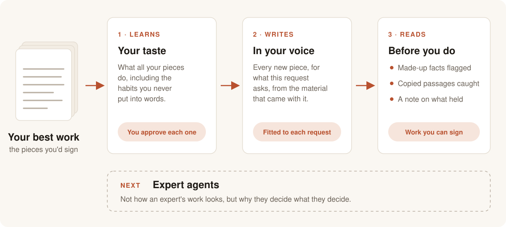

# Atelier

Atelier learns how you write from the pieces you'd sign. Then it writes new ones that way. Before it writes, it asks only what you alone can say. Before you see the result, it reads the piece for anything made up.

[](https://github.com/yannickYamo/atelier/actions/workflows/ci.yml)
[](LICENSE)
[](package.json)

<p align="center"></p>

## What it's like

Say you have six engineering posts you're happy with. Here they are the six sample posts in [examples/blog](examples/blog). You build an agent from them:

```text
$ atelier new ./posts "blog posts like these" --name posts

Reading your pieces…

How these 6 pieces are written:
  - Headings are blunt declarative sentences naming the action or finding…
      "We deleted our staging environment"
  - Opens mid-situation with a date, a number, or a bare fact; never scene-sets or greets the reader.
      "It cost $14k a month and it had not caught a production bug in seven months."
  - Each piece is a short post-mortem of one concrete change already made and lived with…
      "Here is what we actually did about it."

Engineering blog posts, to share what one team changed and what it learned.
  Enter to keep, or say it in your words:

"posts" is ready.
```

Each habit comes with a sentence of yours, so you can see where it came from. If the last line is wrong, type it the way you'd say it.

Now you want a post. You have a page of notes about flaky tests:

```text
$ atelier run "A post on how we stopped flaky tests from blocking merges, for other engineering teams" --with notes=notes.md

Point: What do you believe about flaky tests that most teams get wrong?
  a) Re-running is the real cost, not the flaky tests
  b) Blocking merges on unowned tests trains people to ignore CI
  c) Quarantine with owner and deadline beats fixing flakes ad hoc
  enter for a, or your own words:
Proof: What went wrong or surprised you during the six weeks that you'll put on record?
  your words, or enter to skip: The 0.4 figure is from our CI dashboard, Nov 1 to Dec 15
For: Which team situation should the closing if-then prompt address?
  a) Teams where engineers habitually re-run CI instead of reading failures
  b) Teams with a large suite and a shared main branch
  c) Teams considering a quarantine label for the first time
  enter for a, or your own words:
Anything else? Say it, or enter to write:

# The expensive part of a flaky test is the re-run

…

The cost was somewhere else. The typical merged PR needed 2.3 re-runs before it went green.
Engineers had learned that a red pipeline usually means nothing, so they stopped reading failures
and started clicking the button.
…
I do not think we fixed our tests. I think we made a red pipeline mean something again, and
people went back to reading it.

Not right? atelier fix "<what was wrong>"
```

That's real output, shortened. Atelier asked three things: what you think, what you can vouch for, and who it's for. It asks only what your notes don't already say. It never asks something it can decide itself, like how to open or what order to use. Press Enter and you get the suggestion.

The piece is in the voice of your six posts. It uses only figures from your notes and your answer. If a sentence holds a name or a figure you never gave, it's quoted under the piece:

```text
Check: "I am not going to claim the 7 are fine." (not in your notes)
```

Don't like something? Say it in your own words: `atelier fix "open on the 2.3 re-runs"`. Only the sentences you mean change. Add `--always` and every later piece changes the same way.

## Why this exists

Every team runs agents now, and out of the box they all sound the same. What's scarce is your own standard: how you open, what you cut, what you'd never say. Most of it was never written down. You know good when you see it.

The other problem is trust. Fluent drafts invent. They add a survey, a figure, a story that sounds like yours because it was built from yours. You're the one who signs it.

Atelier handles both. It learns the standard from finished work, so you don't have to describe it. And it reads every piece against your notes before the piece reaches you.

## How it works

1. **It reads your pieces.** It looks at what they all have in common: some of it countable (paragraph length, how pieces open, words you never use), some of it not (where you commit, where you hedge, how you close). It shows each habit beside a sentence of yours.
2. **It asks what only you know.** Your point, what the piece should do, what you can put on record, and who reads it. At most three questions, and only the ones your notes leave open.
3. **It writes from your own pieces.** It doesn't write from a description of your style. The writer sees your pieces of that kind whole, plus your notes, your answers and any rules you've stated. Then one review fixes only what you wouldn't write.
4. **It reads the piece before you do.** Every name and figure is checked against your notes and answers. A passage lifted from one of your old pieces is caught. A rule you stated and require is held, and the sentence that breaks it is rewritten.

A rule you state stays in your words. No model rewords it later. Everything is recorded: what each piece was written from, what was checked and what was found.

## Try it

```bash
git clone https://github.com/yannickYamo/atelier && cd atelier
npm install && npm run build && npm link

atelier new ./my-posts "blog posts like these" --name posts   # build from your pieces
atelier run "a post on why we moved off the queue" --with notes=notes.md   # write one
atelier fix "the opening is too abstract"   # change what you mean, nothing else
```

You need Node 22 or later and an `ANTHROPIC_API_KEY`, or any OpenAI-compatible backend. `atelier check` tests the key before anything is spent. Got a written method, like "open with the decision, give the cost in the second paragraph"? Add `--method method.md` and each step becomes a rule.

**In Claude Code.** The build installs the agent as a skill. Type `/posts` and Claude asks you the same few questions, writes the piece, then runs `atelier verify` on it before handing it back. `atelier setup` lets Claude Code or Codex call Atelier on any draft.

No writing of your own to try it on? [examples/blog](examples/blog) has six sample posts.

## Questions you might have

**How is this different from pasting my posts into Claude or ChatGPT?**
The writing is about as good. On 25 blind-judged briefs, Atelier came out level with pasting your posts. What pasting doesn't give you: the questions before the draft, the check of every figure against your notes, your rules held on every piece, fixes that change only the sentences you mean, and the same standard every time, for anyone on your team.

**Isn't this just a good system prompt?**
A prompt can only ask for what you can put into words, and the model may or may not follow it. Atelier reads your standard off your finished pieces, including the parts you never said out loud. It shows you each habit with your sentence, writes from the pieces themselves, and checks the parts that can be counted.

**How is it different from a prompt optimiser like DSPy or GEPA?**
An optimiser changes the prompt until a score goes up. It needs a score, and it can quietly break anything the score doesn't measure. Atelier works on the score itself: it learns your standard from your work and holds it fixed. A rule you state is never reworded by a model, and a check a model writes doesn't get to block anything until it has passed on your own examples.

**And from an LLM judge?**
A judge gives a draft a 7 out of 10 against its own idea of good, which is everyone's average. Atelier names the sentence and the rule it broke, or the figure that isn't in your notes.

**Does it make things up?**
It can. Every model can. Atelier doesn't claim to stop that. What it does is catch it: in testing, it caught 46 of 46 planted inventions. It also flagged about one clean draft in five, so a flagged line is something to look at, not a verdict.

**What does it cost?**
A piece takes about 3 minutes and about $0.40 on Claude, paid to your own model provider. `atelier check` tests your key before anything is spent.

**Where does my writing go?**
To the model provider you set up, and nowhere else. No account, no telemetry. Everything Atelier keeps is in `~/.atelier`.

**What kinds of writing does it suit?**
Blog posts, essays, newsletters, release notes, announcements, memos: anything you or your team write often and want to sound like yourselves. An agency can keep one agent per client, a content team one per voice. Decision documents (PRDs, strategy) are partly covered: Atelier keeps their voice and checks their facts, but it doesn't make the call better. See [EVALS](EVALS.md).

**Do I still need to read it?**
Yes. You still sign it. Atelier moves your judgement earlier, into the standard, and points you at the few lines that need you.

## What's been measured

- **46 of 46 planted inventions caught** in drafts the check had never seen.
- **Counted rules held:** 31% of answers broke one, against 76% for a hand-written skill.
- **Writing level with pasting your own posts** on 25 blind-judged briefs, and ahead of the bare model on 24 of them. Against a paste plus one review, it is behind: 4 won, 11 tied, 10 lost.

[EVALS](EVALS.md) has how each was measured, and what isn't shown yet.

## Where it's going

One standard has three uses. Writing from it ships today. Checking someone else's draft against it comes next, and `atelier verify` is the start. The third is grading, where the same standard judges a model you train or choose.

Writing is the first expert it learned, not the last. An expert isn't defined by how their output looks. It's defined by why they decide what they decide: which number they question, what they cut, when they push back. That judgement rarely makes it into the written procedure. Atelier is learning that part.

## Why I built it

I was signing agent-written drafts I hadn't fully read. The responsibility didn't shrink when the typing did. It moved, from writing the sentence to signing for it. Atelier is there so that signature means something again.

## More

[USAGE](docs/USAGE.md) has every command. [AGENTS.md](AGENTS.md) is the short version for a coding agent. [EVALS](EVALS.md) is what was measured and what wasn't. [MEASUREMENTS](MEASUREMENTS.md) lists every figure a code comment states. [What a standard holds](docs/STANDARD.md).

## License

MIT. See [LICENSE](LICENSE). Reports of what it got right and wrong on your own writing are welcome: see [CONTRIBUTING](CONTRIBUTING.md).
